<!-- ============ HERO BANNER (single animated banner) ============ -->

<!-- status line enhanced -->

<!-- stars + followers -->

  
  

<!-- social icon badges -->

  
  
  
  
  
  

  <a href="#about">About</a> ·
  <a href="#building">Building</a> ·
  <a href="#stack">Tech Stack</a> ·
  <a href="#projects">Projects</a> ·
  <a href="#art">Art</a> ·
  <a href="#activity">Activity</a> ·
  <a href="#stats">Stats</a> ·
  <a href="#connect">Connect</a>

## 👨‍💻 About Me

- 🎓 Pursuing **MCA** at **Lloyd Institute of Engineering and Technology**
- 💻 Focused on **Web Development, Full-Stack Development and AI-powered applications**
- 🤖 Interested in integrating AI into practical products and developer tools
- 🚀 Building projects that solve real-world problems
- 🌱 Continuously learning modern JavaScript, React, Next.js, backend development and AI technologies
- 📫 Reach me: **harshdubey3340@gmail.com**
- ⚡ Fun fact: I love turning ideas into interactive web experiences!

## 🚀 Currently Building

### SkillNexAI — AI-Powered Job Preparation & Placement Platform

A full-stack placement-preparation platform designed to help students prepare for technical interviews and job opportunities.

✨ Explore planned features

- 📄 Resume analysis
- 🎯 AI-generated technical questions
- 🎤 Voice-based mock interviews
- 📊 Interview feedback and evaluation
- 💼 Job-preparation workflows
- 🤖 AI-assisted learning and career preparation
[Explore SkillNex-AI on GitHub →](https://github.com/HarshDubey79/SkillNex-AI)

  
  

## 🛠️ Tech Stack

🔎 Click to explore my tech stack

**Languages:**
`C` `C++` `Java` `Python` `JavaScript` `HTML` `CSS`

**Frontend:**
`React.js` `Next.js` `Bootstrap` `Tailwind CSS`

**Backend:**
`Node.js` `Express.js` `Django` `Spring Boot`

**Database:**
`PostgreSQL` `SQL` `MongoDB`

**AI / ML:**
`Python` `NumPy` `Pandas` `Scikit-learn` `Google Gemini` `AI APIs`

**Tools & Cloud:**
`Git` `GitHub` `VS Code` `Docker` `AWS` `Azure`

# 💻 Tech Stack

                                

## 📌 Featured Projects

| Project | Description |
|---|---|
| [SkillNex-AI](https://github.com/HarshDubey79/SkillNex-AI) | AI-powered job preparation and placement platform |
| [Portfolio Website](https://github.com/HarshDubey79/Portfolio-Website) | Personal portfolio showcasing skills and projects |
| [Full-stack E-commerce](https://github.com/HarshDubey79/full-stack-e-commerce) | E-commerce web application |
| [MovieHub](https://github.com/HarshDubey79/MovieHub) | Simple movies website |

## 🎯 Current Focus

- Advanced **Next.js & React**
- AI integration and LLM-powered applications
- Full-stack application architecture
- PostgreSQL and backend development
- Cloud deployment and developer tooling
- Building portfolio-ready real-world projects

## 🖥️ Animated Profile Art

  
  &nbsp;&nbsp;
  

  

## 📊 GitHub Activity

## 📈 GitHub Stats

### ✍️ Random Dev Quote

## 🐍 Snake Game

## 🔗 Connect with Me

<!-- single animated social pills strip -->

  

  

  

---

**Building • Learning • Improving • Shipping 🚀**

<!-- Proudly created with GPRM ( https://gprm.itsvg.in ) -->
